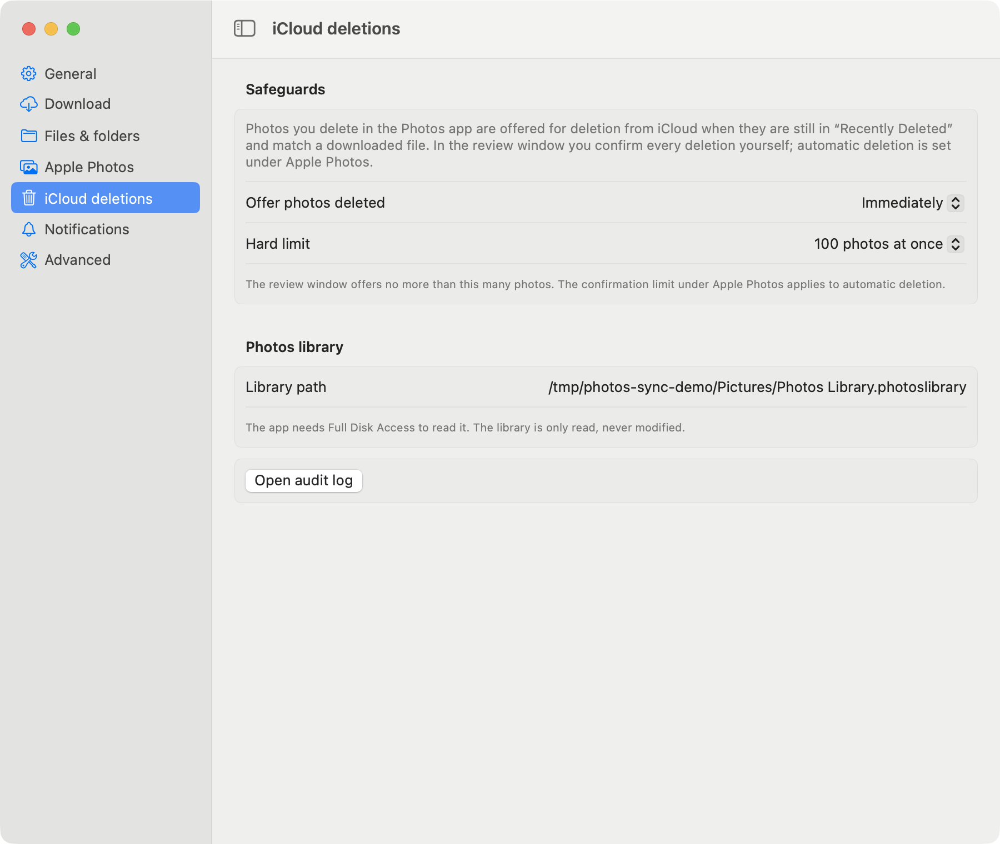

# Photos Sync

A macOS menu bar app around [`icloudpd`](../README.md). It keeps the newest photos of your iCloud library on your
Mac, shows what is happening in the menu bar, can import the downloaded photos into the Apple **Photos** app, and can
delete from iCloud (and the disk) the photos you delete in Photos.

<p align="center"></p>

- [What it does](#what-it-does)
- [Requirements](#requirements)
- [Install](#install)
- [First start](#first-start)
- [The menu](#the-menu)
- [Settings](#settings)
- [Import into Photos](#import-into-photos)
- [Deleting what you deleted in Photos](#deleting-what-you-deleted-in-photos)
- [When something goes wrong](#when-something-goes-wrong)
- [Where the app keeps its data](#where-the-app-keeps-its-data)
- [How it works](#how-it-works)
- [Build, tests, screenshots](#build-tests-screenshots)
- [Limits and things to know](#limits-and-things-to-know)

## What it does

- **Syncs on a schedule and on demand.** The newest N photos (default 20) are checked every hour (configurable);
  *Sync now* checks right away. Only photos that are not downloaded yet are fetched.
- **Shows the state in the menu bar icon and the panel**: idle, syncing with progress, up to date with the time to the
  next sync, two-factor code needed, problem.
- **Keeps a history of synced files** (Sync Activity, like OneDrive's), where each file can be opened or revealed in
  Finder.
- **Imports downloaded photos into Apple Photos** automatically (off by default).
- **Mirrors deletions**: photos you delete in Photos can be deleted from iCloud, from the disk (moved to the Trash), or
  both, by hand or automatically (all off by default, with a safety limit and a confirmation).
- **Fixes itself where it can** (network trouble, a leftover process holding the port) and tells you with a macOS
  notification when it cannot.

## Requirements

- macOS 13 or newer (developed and tested on macOS 26).
- The **`icloudpd` of this repository**. The app talks to it through a small local API (`/api/status`,
  `/api/activity`) and uses the options `--webui-host` and `--delete-list`, which are not in the upstream release yet.
  With a plain upstream `icloudpd` the app does not start the sync.
- Swift command line tools to build the app (`xcode-select --install`). Full Xcode is not needed.

## Install

1. Get `icloudpd` running from this repository. The app starts it with a Python of your choice and the `src` folder of
   this checkout, so the simplest way is to install upstream `icloudpd` (for example with Homebrew, which brings all
   dependencies) and point the app to the sources of this repository (step 3).
2. Build and copy the app:

   ```bash
   cd menubar_app
   ./build_app.sh
   cp -R "build/Photos Sync.app" ~/Applications/
   open "$HOME/Applications/Photos Sync.app"
   ```

3. Open **Settings, Advanced** and set
   - **Python**: the interpreter that runs `icloudpd`. It is detected from the `icloudpd` launcher (for example
     Homebrew's), otherwise `/usr/bin/python3`.
   - **icloudpd sources (src folder)**: the `src` folder of this repository.

The app is signed ad hoc, so macOS may ask again for the permissions below after you rebuild it.

## First start

1. Open the panel, click the gear, **General**, and type your Apple ID.
2. Click **Link Account**. A page opens in your browser (served by `icloudpd` on `127.0.0.1:8080`) where you enter the
   password and the two-factor code. The password is stored in the macOS keychain.
3. When the account shows **Linked**, syncing starts. Linking and syncing share the port 8080, so syncing is paused
   while you link.

<p align="center"></p>

Once linked, the button turns into **Unlink**: it stops the sync, removes the saved iCloud session and clears the Apple
ID, so another account can be linked. Your keychain password and the downloaded photos stay.

Permissions the app may ask for:

| Permission | Needed for |
|---|---|
| Notifications | two-factor requests, problems, deletion confirmations (set them to **Alerts** to keep the *Delete* button visible) |
| Automation, control of Photos | importing into Photos |
| Full Disk Access | reading the Photos library to see what you deleted there (it is only read) |

## The menu

| State | Panel |
|---|---|
| Syncing |  |
| Two-factor code needed |  |

- **Sync now** ends the waiting period and checks iCloud immediately. The header shows *Syncing now…* at once.
- **Start / Stop syncing** starts or stops the background sync.
- **Import into Photos** is a quick switch for [automatic import](#import-into-photos).
- **Review iCloud deletions…** opens the [review window](#deleting-what-you-deleted-in-photos).
- The row with the green check opens **Sync Activity**; the gear opens **Settings**; the three dots open the web UI,
  the log, and Quit.

**Sync Activity** lists the files that were synced, newest first. Click a file to open it, or use the dots for *Show in
Finder* and *Copy path*. A file that was imported is marked *in Photos*. The list survives restarts.

<p align="center"></p>

## Settings

Every option is passed to `icloudpd` only when it differs from its own default. Changes to sync options apply after
**Stop** and **Start syncing**.

| Category | What you can set |
|---|---|
| **General** | Apple ID and link status; how often to check (5 min to 24 h); how many of the newest photos each sync looks at (10 to 1,000, or all); start syncing when the app opens; open at login |
| **Download** | photos, videos, Live Photos (Live Photos are **off** by default); photo size and Live Photo video size; albums; library; skip photos created before/after a date |
| **Files & folders** | download folder; folder structure; how existing files are recognised (`name-size-dedup-with-suffix` or `name-id7`); Live Photo video name; RAW and JPEG handling; Unicode in names; XMP sidecars; EXIF date |
| **Apple Photos** | [import](#import-into-photos); [automatic deletion](#deleting-what-you-deleted-in-photos) from iCloud and from the disk; the confirmation limit |
| **iCloud deletions** | how long ago a photo must have been deleted before it is offered; a hard limit for the review window; the path of the Photos library |
| **Notifications** | notify when a code or password is needed, and when syncing fails |
| **Advanced** | extra early stop after N known photos in a row; Python and sources; log level |

<table>
<tr>
<td></td>
<td></td>
</tr>
<tr>
<td></td>
<td></td>
</tr>
<tr>
<td></td>
<td></td>
</tr>
</table>

## Import into Photos

Turn on **Import into Photos** (panel or **Apple Photos** settings). Every file `icloudpd` downloads from then on is
imported with AppleScript into the library the Photos app has open, normally the System Photo Library. The app
remembers what it imported and does not import a file twice; Photos skips photos it already has. Photos opens when
something is imported.

**Files downloaded so far** in the same settings pane counts the files that are not imported yet and imports them
after you confirm.

## Deleting what you deleted in Photos

`icloudpd` only downloads, so a photo you delete in Photos stays in iCloud and on the disk. The app can follow your
deletions. It reads the **Recently Deleted** of the Photos library (read only, from a copy of the database) and keeps
the photos that match a file downloaded by `icloudpd` (same original file name, which includes the `name-id7` suffix, and
the same size). Only those are touched.

Photos deleted from iCloud go to iCloud's *Recently Deleted* for about 30 days; files deleted from the disk go to the
Trash. Nothing is removed for good.

**By hand**: *Review iCloud deletions…* lists the matches. *Dry run* shows what would happen; *Delete from iCloud…* and
*Delete from iCloud & Disk…* ask for confirmation first.

<p align="center"></p>

**Automatically**: in **Apple Photos** settings, two separate switches, both **off** by default:

- *Delete them from iCloud automatically*
- *Delete them from the disk automatically (moves the files to the Trash)*

They run after every sync. With both on, a file is only moved to the Trash after iCloud confirmed the deletion. Mind that
a photo deleted only from the disk can be downloaded again while it is among the newest photos in iCloud.

**Safety limit**: when more than N photos (default 20, changeable) would be deleted at once, nothing happens until you
confirm. You get a notification with *Delete* and *Not now* buttons, and the panel shows a row for the waiting photos.
The limit can be switched off with the parent switch *Ask for confirmation when many photos are deleted at once*; then any
number is deleted without asking. Further safeguards:

- an optional minimum age (deleted at least N days ago);
- a hard limit for the review window (default 100);
- if the iCloud deletion fails, the files on the disk are kept;
- every dry run and deletion is appended to `~/Library/Logs/icloudpd-menubar/deletions.log`.

## When something goes wrong

The header only says *Sync problem*; the details are written to the log (*three dots, Open log*), where the app also
writes its own steps.

The app looks at the log and at the process and reacts:

| Problem | Reaction |
|---|---|
| iCloud cannot be reached, or another error | tries again after 30 s, 2 min and 5 min |
| Port 8080 is held by an `icloudpd` left over from an earlier run | stops that process and restarts the sync |
| Sign-in is no longer valid | stops and tells you to link the account again |

If recovery does not help, a macOS notification explains what is wrong. The counter of attempts resets after ten quiet
minutes.

## Where the app keeps its data

| Path | Content |
|---|---|
| `~/Library/Logs/icloudpd-menubar/icloudpd.log` | `icloudpd` output and the app's own messages |
| `~/Library/Logs/icloudpd-menubar/deletions.log` | audit log of dry runs, deletions and moves to the Trash |
| `~/Library/Application Support/icloudpd-menubar/` | `activity.json` (history), `imported.json`, `deleted-from-icloud.json` |
| `~/.pyicloud/` | the iCloud session, written by `icloudpd` |
| macOS preferences, `com.marlo.icloudpd-menubar` | the settings |

## How it works

```
Photos Sync (SwiftUI)
  ├─ starts   icloudpd --watch-with-interval … --recent N --webui-host 127.0.0.1 --mfa-provider webui …
  ├─ polls    GET  http://127.0.0.1:8080/api/status     state, progress, countdown
  │           GET  http://127.0.0.1:8080/api/activity   files downloaded by this icloudpd run
  ├─ acts     POST /resume (Sync now)                   ends the waiting period
  ├─ reads    Photos.sqlite (a copy)                    what is in Recently Deleted
  ├─ runs     icloudpd --delete-list FILE               deletes the matches in iCloud
  └─ imports  osascript → Photos                        new downloads
```

- `icloudpd` finds a photo in iCloud without a search: iCloud cannot query by name or size, but the library is ordered by
  date. `--delete-list` first reads the newest 100 photos with one request and only then falls back to a binary search over
  the date, so recent photos are found in a few seconds.
- The web UI of `icloudpd` has no password. The app binds it to `127.0.0.1`; the option `--webui-host` controls that.
- The API and the options are documented in [docs/webui.md](../docs/webui.md) and [docs/reference.md](../docs/reference.md).

## Build, tests, screenshots

```bash
cd menubar_app
./build_app.sh [output-dir]      # default: ./build → "Photos Sync.app"
swift run candidates-cli         # prints what the app would offer for deletion (read only)
```

- The Swift package builds in `~/Library/Caches/icloudpd-menubar/build` and not in this folder, because a synced folder
  (OneDrive, iCloud Drive) corrupts SwiftPM's build database. Set `SCRATCH_PATH` to change it.
- The app icon is the icon of the Apple Photos app, copied from `/System/Applications/Photos.app` while building. It is
  not part of this repository; if it is missing, a generated icon is used.
- Python tests: `tests/test_delete_list.py` and `tests/test_activity.py`.
- The screenshots in `docs/images` were taken from a demo instance with made-up data. The environment variables
  `PHOTOSSYNC_HOME` (folder for the app's own data) and `PHOTOSSYNC_DOC` (open a window or pane at start, such as
  `settings:photos`, `review` or `activity`) exist for that and are not needed in normal use.

## Limits and things to know

- The web UI port is fixed at 8080.
- Photos Sync links and syncs one Apple ID.
- Photos itself decides what a duplicate is when importing; the behaviour for a photo that exists in Photos was not
  tested in depth.
- Matching deleted photos by name and size can mis-match two different photos that share both; such photos are reported
  as ambiguous and skipped.
- Notification buttons (*Delete*, *Not now*) need the notification style *Alerts* for Photos Sync.
- The app is not notarised. Build it yourself, as described above.
