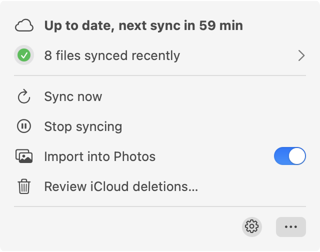
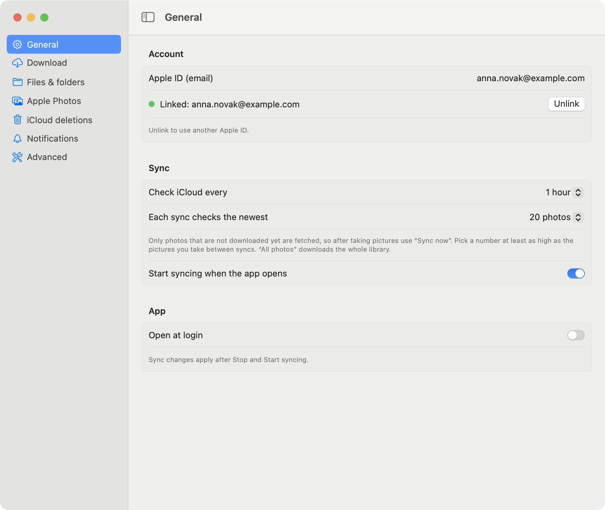
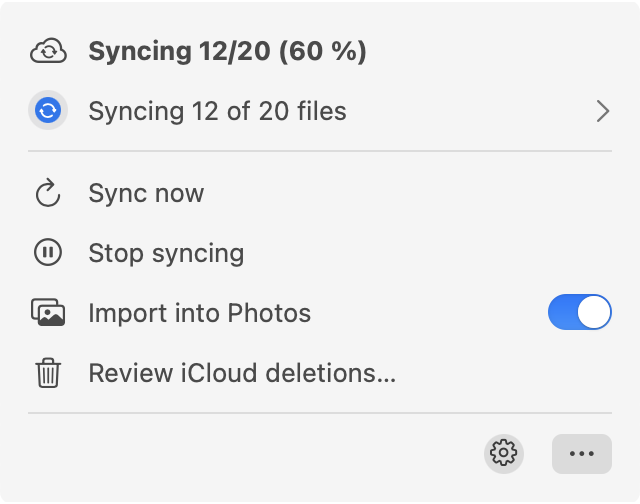
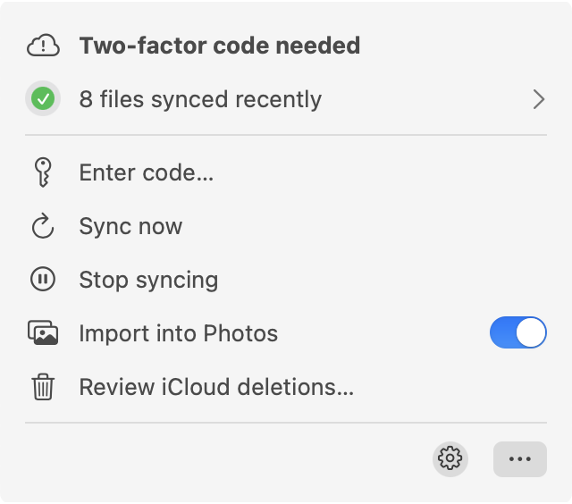
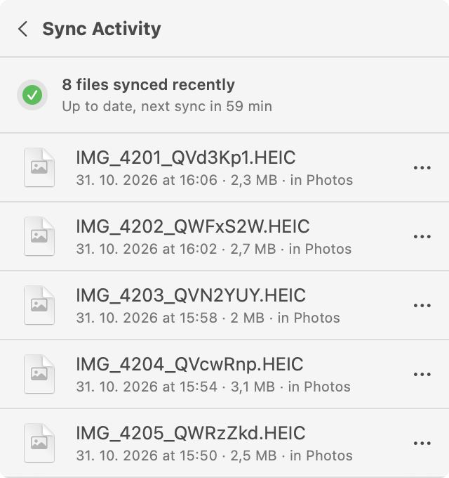
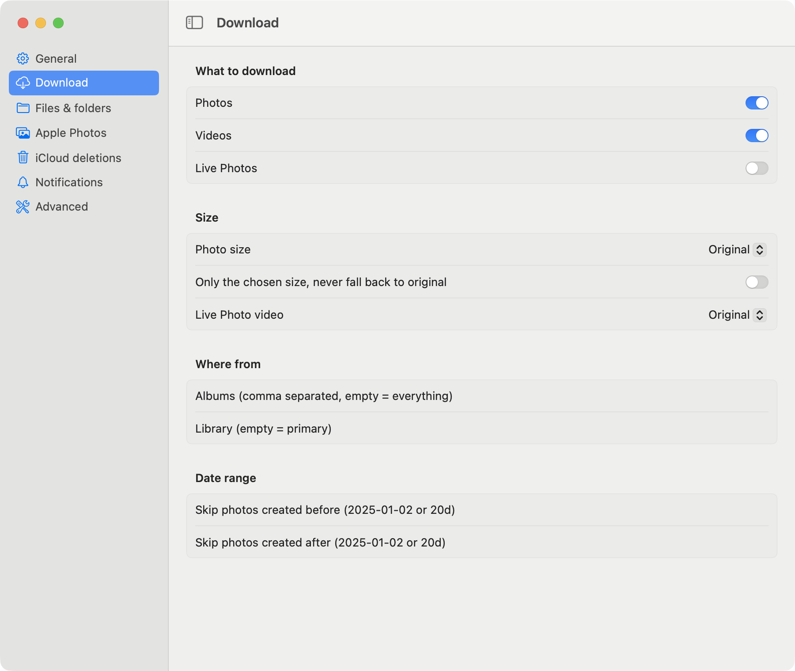
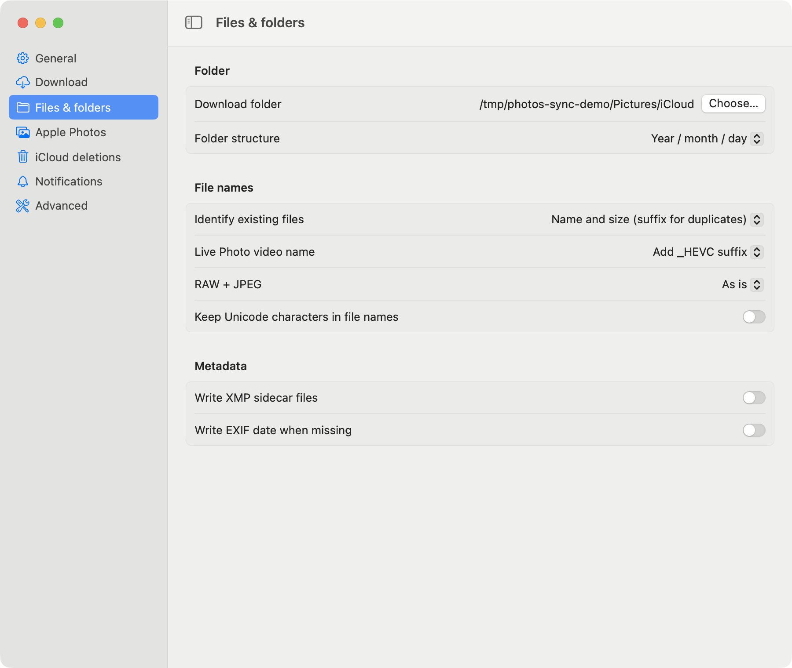
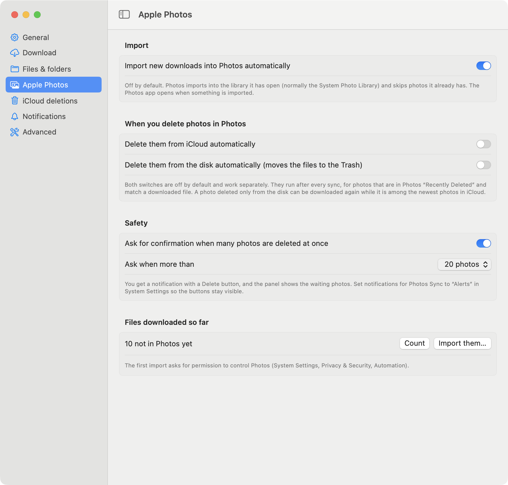
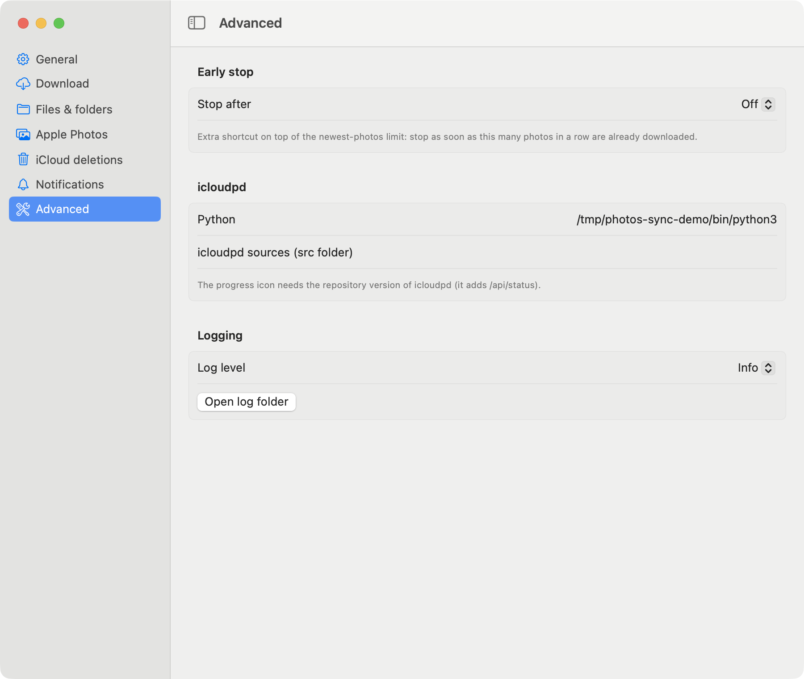
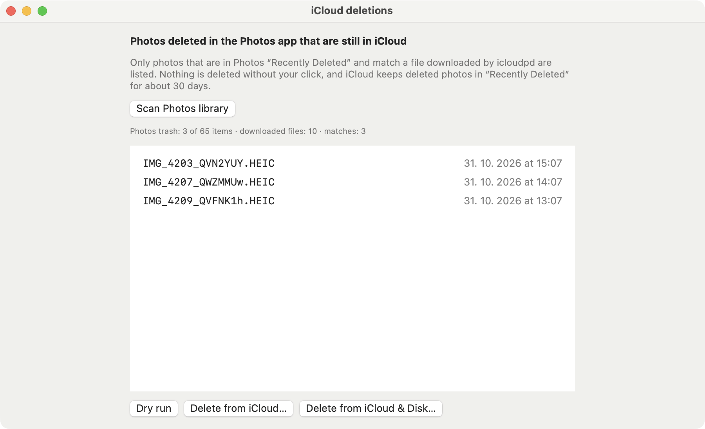

# Photos Sync

A macOS menu bar app around [`icloudpd`](../README.md). It keeps the newest photos of your iCloud library on your
Mac, shows what is happening in the menu bar, can import the downloaded photos into the Apple **Photos** app, and can
delete from iCloud (and the disk) the photos you delete in Photos.

<p align="center"></p>

- [What it does](#what-it-does)
- [Requirements](#requirements)
- [Install](#install)
- [First start](#first-start)
- [The menu](#the-menu)
- [Settings](#settings)
- [Import into Photos](#import-into-photos)
- [Saving photos you add to Photos](#saving-photos-you-add-to-photos)
- [Deleting what you deleted in Photos](#deleting-what-you-deleted-in-photos)
- [Deleting what you deleted in iCloud](#deleting-what-you-deleted-in-icloud)
- [When something goes wrong](#when-something-goes-wrong)
- [Where the app keeps its data](#where-the-app-keeps-its-data)
- [How it works](#how-it-works)
- [Build, tests, screenshots](#build-tests-screenshots)
- [Limits and things to know](#limits-and-things-to-know)

## What it does

- **Syncs on a schedule and on demand.** The newest N photos (default 20) are checked every hour (configurable);
  *Sync now* checks right away. Only photos that are not downloaded yet are fetched.
- **Shows the state in the menu bar icon and the panel**: idle, syncing with progress, up to date with the time to the
  next sync, two-factor code needed, problem.
- **Keeps a history** (Sync Activity, like OneDrive's) of the files that were synced and of the deletions the app
  carried out (from iCloud, from Photos, moved to the Trash), where each file can be opened or revealed in Finder.
- **Imports downloaded photos into Apple Photos** automatically (off by default), and can save a copy of the photos
  you add to Photos yourself to the download folder (off by default).
- **Mirrors deletions in both directions**: photos you delete in Photos can be deleted from iCloud and from the disk
  (moved to the Trash), and photos you delete in iCloud can be removed from the disk and from Photos. By hand or
  automatically; everything automatic is off by default and has a safety limit with a confirmation.
- **Fixes itself where it can** (network trouble, a leftover process holding the port) and tells you with a macOS
  notification when it cannot.

## Requirements

- macOS 13 or newer (developed and tested on macOS 26).
- An installed `icloudpd`, for example `brew install icloudpd`. The app uses its Python and its libraries, but runs the
  **`icloudpd` of this repository**, which it carries inside (the `src` folder is copied into the app when it is built).
  That version has the small local API (`/api/status`, `/api/activity`) and the options `--webui-host` and
  `--delete-list`, which the upstream release does not have yet.
- Swift command line tools to build the app (`xcode-select --install`). Full Xcode is not needed.

## Install

1. Install `icloudpd` so that its Python and libraries are there (for example `brew install icloudpd`).
2. Build and copy the app:

   ```bash
   cd menubar_app
   ./build_app.sh
   cp -R "build/Photos Sync.app" ~/Applications/
   open "$HOME/Applications/Photos Sync.app"
   ```

The app finds the Python of the installed `icloudpd` by itself. Only if you want another Python or another `icloudpd`
is there **Settings, Advanced, Use another icloudpd**.

The app is signed ad hoc, so macOS may ask again for the permissions below after you rebuild it.

## First start

1. Open the panel, click the gear, **General**, and type your Apple ID.
2. Click **Link Account**. A page opens in your browser (served by `icloudpd` on `127.0.0.1:8080`) where you enter the
   password and the two-factor code. The password is stored in the macOS keychain.
3. When the account shows **Linked**, syncing starts. Linking and syncing share the port 8080, so syncing is paused
   while you link.

<p align="center"></p>

Once linked, the button turns into **Unlink**: it stops the sync, removes the saved iCloud session and clears the Apple
ID, so another account can be linked. Your keychain password and the downloaded photos stay.

Permissions the app may ask for:

| Permission | Needed for |
|---|---|
| Notifications | two-factor requests, problems, deletion confirmations (set them to **Alerts** to keep the *Delete* button visible) |
| Automation, control of Photos | importing into Photos |
| Full Disk Access | reading the Photos library to see what you deleted there (it is only read) |
| Photos | removing photos from Photos that you deleted in iCloud (macOS also asks for confirmation every time) |

## The menu

| State | Panel |
|---|---|
| Syncing |  |
| Two-factor code needed |  |

- **Sync now** ends the waiting period and checks iCloud immediately. The header shows *Syncing now…* at once.
- **Start / Stop syncing** starts or stops the background sync.
- **Open Photos** opens the Photos app.
- **Review iCloud deletions…** opens the [review window](#deleting-what-you-deleted-in-photos).
- The row with the green check opens **Sync Activity**; the gear opens **Settings**; the three dots open the web UI,
  the log, and Quit.

**Sync Activity** lists the files that were synced, newest first, and the deletions the app carried out, marked with a red
trash can and *Deleted from iCloud*, *Deleted from Photos* or *Moved to Trash*. Click a file to open it, or use the dots
for *Show in Finder* and *Copy path*. A file that was imported is marked *in Photos*. The list survives restarts.

<p align="center"></p>

## Settings

Every option is passed to `icloudpd` only when it differs from its own default. Changes to sync options apply after
**Stop** and **Start syncing**.

| Category | What you can set |
|---|---|
| **General** | Apple ID and link status; how often to check (5 seconds to 24 hours); how many of the newest photos each sync looks at (10 to 1,000, or all); start syncing when the app opens; open at login |
| **Download** | photos, videos, Live Photos (Live Photos are **off** by default); photo size and Live Photo video size; albums; library; skip photos created before/after a date |
| **Files & folders** | download folder; folder structure; how existing files are recognised (`name-size-dedup-with-suffix` or `name-id7`); Live Photo video name (by default the same as the photo, so that Photos pairs them); RAW and JPEG handling; Unicode in names; XMP sidecars; EXIF date |
| **Apple Photos** | [import](#import-into-photos); [saving what you add to Photos](#saving-photos-you-add-to-photos); [deleting what you delete in Photos](#deleting-what-you-deleted-in-photos) (from iCloud and from the disk) and [what you delete in iCloud](#deleting-what-you-deleted-in-icloud) (from the disk and from Photos); how long to wait after deleting; the confirmation limit; the path of the Photos library |
| **Notifications** | notify when a code or password is needed, and when syncing fails |
| **Advanced** | extra early stop after N known photos in a row; log level; another Python or `icloudpd` (normally nothing to change here) |

<table>
<tr>
<td></td>
<td></td>
</tr>
<tr>
<td></td>
<td></td>
</tr>
</table>

## Import into Photos

Turn on **Import new downloads into Photos automatically** in the **Apple Photos** settings. Every file `icloudpd` downloads from then on is
imported with AppleScript into the library the Photos app has open, normally the System Photo Library. The app
remembers what it imported and does not import a file twice; Photos skips photos it already has. Photos opens when
something is imported.

**Files downloaded so far** in the same settings pane counts the files that are not imported yet and imports them
after you confirm.

## Saving photos you add to Photos

The other direction of the import. Turn on **Save a copy to the download folder** in the **Apple Photos** settings,
and every photo you add to Photos afterwards (by hand, from a camera, with AirDrop) is copied to the download folder,
in the same folder structure as the downloaded photos, with the modification date set to the date it was taken.

- Only photos added after you turn the switch on are saved. The app asks Photos what is new through PhotoKit's change
  history, so nothing is guessed from dates.
- Photos that came from the download folder in the first place are recognised by their file name and date and skipped,
  and the saved files are never imported into Photos again.
- A file name that is already taken gets `_Photos` added (`IMG_1_Photos.HEIC`).
- Saved files show in Sync Activity with a blue arrow.
- PhotoKit only sees the System Photo Library, and the app asks once for permission to access Photos.
- **Uploading to iCloud is not part of this.** `icloudpd` only downloads, and there is no supported way to upload from
  here. To get photos from Photos into iCloud, turn on iCloud Photos in the Photos app.

## Deleting what you deleted in Photos

`icloudpd` only downloads, so a photo you delete in Photos stays in iCloud and on the disk. The app can follow your
deletions. It reads the **Recently Deleted** of the Photos library (read only, from a copy of the database) and keeps
the photos that match a file downloaded by `icloudpd` (same original file name, which includes the `name-id7` suffix, and
the same size). Only those are touched.

Photos deleted from iCloud go to iCloud's *Recently Deleted* for about 30 days; files deleted from the disk go to the
Trash. Nothing is removed for good.

**By hand**: *Review iCloud deletions…* lists the matches. *Dry run* shows what would happen; *Delete from iCloud…* and
*Delete from iCloud & Disk…* ask for confirmation first.

<p align="center"></p>

**Automatically**: in **Apple Photos** settings, two separate switches, both **off** by default:

- *Delete them from iCloud automatically*
- *Delete them from the disk automatically (moves the files to the Trash)*

They run after every sync and about half a minute after something changes in Photos, so a photo you delete there is
handled soon and not at the next sync. With both on, a file is only moved to the Trash after iCloud confirmed the
deletion. If iCloud cannot be reached, the app tries again after 5 minutes, up to three times. Mind that
a photo deleted only from the disk can be downloaded again while it is among the newest photos in iCloud.

**Safety limit**: when more than N photos (default 20, changeable) would be deleted at once, nothing happens until you
confirm. You get a notification with *Delete* and *Not now* buttons, and the panel shows a row for the waiting photos.
The limit can be switched off with the parent switch *Ask for confirmation when many photos are deleted at once*; then any
number is deleted without asking. Further safeguards:

- an optional wait (deleted at least N days ago);
- if the iCloud deletion fails, the files on the disk are kept;
- every dry run and deletion is appended to `~/Library/Logs/icloudpd-menubar/deletions.log`.

## Deleting what you deleted in iCloud

The other direction. When you delete a photo in iCloud (iPhone, iCloud.com), the downloaded copy stays on the disk and
in Photos. Two separate switches in **Apple Photos** settings, both **off** by default:

- *Delete them from the disk automatically (moves the files to the Trash)*
- *Delete them from Photos automatically (macOS asks you to confirm)*

After every sync the app asks `icloudpd` which downloaded files belong to photos in iCloud's *Recently Deleted* (a dry
run of `--auto-delete`, so nothing is deleted by `icloudpd` itself), and then:

- moves those files to the Trash, and/or
- deletes the photos from the Photos library through PhotoKit. **macOS shows its own confirmation dialog every time**,
  so this can never happen silently, and the photos land in *Recently Deleted* in Photos. PhotoKit only sees the System
  Photo Library, and a photo is matched by its original file name and its date.

The same safety limit as in the other direction applies: above N photos (default 20) nothing happens until you confirm,
through a notification with a *Delete* button or the row in the panel. A photo you decided about is not asked about
again.

Both directions together mean full mirroring: a photo you delete from iCloud with the review window lands in iCloud's
*Recently Deleted*, and with these switches on it disappears from the disk and from Photos as well.

## When something goes wrong

The header only says *Sync problem*; the details are written to the log (*three dots, Open log*), where the app also
writes its own steps.

The app looks at the log and at the process and reacts:

| Problem | Reaction |
|---|---|
| iCloud cannot be reached, or another error | tries again after 30 s, 2 min and 5 min |
| Port 8080 is held by an `icloudpd` left over from an earlier run | stops that process and restarts the sync |
| Sign-in is no longer valid | stops and tells you to link the account again |

If recovery does not help, a macOS notification explains what is wrong. The counter of attempts resets after ten quiet
minutes.

## Where the app keeps its data

| Path | Content |
|---|---|
| `~/Library/Logs/icloudpd-menubar/icloudpd.log` | `icloudpd` output and the app's own messages |
| `~/Library/Logs/icloudpd-menubar/deletions.log` | audit log of dry runs, deletions and moves to the Trash |
| `~/Library/Application Support/icloudpd-menubar/` | `activity.json` (history), `imported.json`, `deleted-from-icloud.json`, `mirrored-from-icloud.json`, `photos-change-token.data` |
| `~/.pyicloud/` | the iCloud session, written by `icloudpd` |
| macOS preferences, `com.marlo.icloudpd-menubar` | the settings |

## How it works

```
Photos Sync (SwiftUI)
  ├─ starts   icloudpd --watch-with-interval … --recent N --webui-host 127.0.0.1 --mfa-provider webui …
  ├─ polls    GET  http://127.0.0.1:8080/api/status     state, progress, countdown
  │           GET  http://127.0.0.1:8080/api/activity   files downloaded by this icloudpd run
  ├─ acts     POST /resume (Sync now)                   ends the waiting period
  ├─ reads    Photos.sqlite (a copy)                    what is in Recently Deleted
  ├─ runs     icloudpd --delete-list FILE               deletes the matches in iCloud
  ├─ runs     icloudpd --auto-delete --dry-run          lists the files of photos deleted in iCloud
  ├─ deletes  PhotoKit (macOS confirms)                 photos from Photos
  ├─ imports  osascript → Photos                        new downloads
  └─ saves    PhotoKit change history                   photos you add to Photos, to the download folder
```

- `icloudpd` finds a photo in iCloud without a search: iCloud cannot query by name or size, but the library is ordered by
  date. `--delete-list` first reads the newest 100 photos with one request and only then falls back to a binary search over
  the date, so recent photos are found in a few seconds.
- The web UI of `icloudpd` has no password. The app binds it to `127.0.0.1`; the option `--webui-host` controls that.
- The API and the options are documented in [docs/webui.md](../docs/webui.md) and [docs/reference.md](../docs/reference.md).

## Build, tests, screenshots

```bash
cd menubar_app
./build_app.sh [output-dir]      # default: ./build → "Photos Sync.app"
swift run candidates-cli         # prints what the app would offer for deletion (read only)
```

- The Swift package builds in `~/Library/Caches/icloudpd-menubar/build` and not in this folder, because a synced folder
  (OneDrive, iCloud Drive) corrupts SwiftPM's build database. Set `SCRATCH_PATH` to change it.
- The app icon is the icon of the Apple Photos app, copied from `/System/Applications/Photos.app` while building. It is
  not part of this repository; if it is missing, a generated icon is used.
- Python tests: `tests/test_delete_list.py` and `tests/test_activity.py`.
- The screenshots in `docs/images` were taken from a demo instance with made-up data. The environment variables
  `PHOTOSSYNC_HOME` (folder for the app's own data) and `PHOTOSSYNC_DOC` (open a window or pane at start, such as
  `settings:photos`, `review` or `activity`) exist for that and are not needed in normal use.

## Limits and things to know

- The web UI port is fixed at 8080.
- Photos Sync links and syncs one Apple ID.
- Photos itself decides what a duplicate is when importing; the behaviour for a photo that exists in Photos was not
  tested in depth.
- Matching deleted photos by name and size can mis-match two different photos that share both; such photos are reported
  as ambiguous and skipped.
- Notification buttons (*Delete*, *Not now*) need the notification style *Alerts* for Photos Sync.
- The app is not notarised. Build it yourself, as described above.
